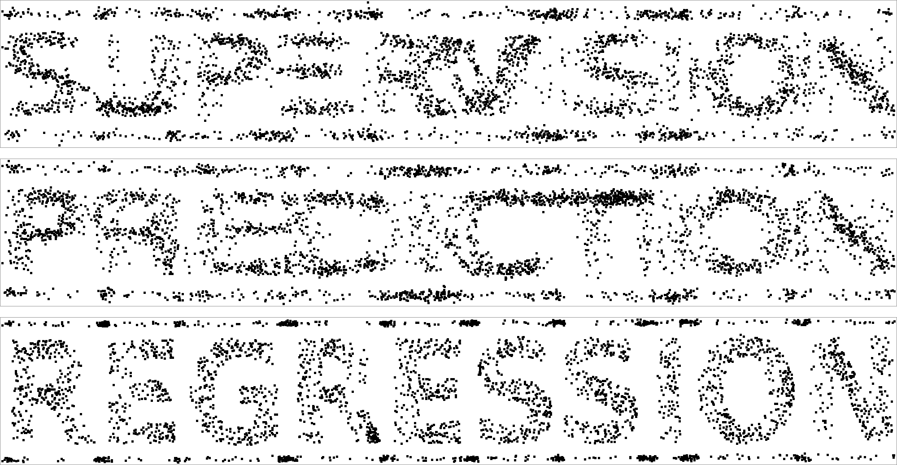

# Fry-ndship (Belgium)

**Flag: `SIGMOID_SUPERVISION`**



Panels from top to bottom: `hedge_m` → **SUPERVISION**, `edge_m` → PREDICTION, `ditch_m` → REGRESSION.
The x-axis is the field's geometric perimeter and the y-axis is the residual of each column's linear model.

## How it was found
1. A field's edge is its geometric perimeter plus its ditch and hedge. For a rectangle,
   `P = 2 * (long_side + area / long_side)` with `area = area_ha * 1e4`.
   Fitting `edge_m ~ 0.41 * P + 1.00 * ditch_m + 1.00 * hedge_m` gives a residual sd of only 0.05 m.
   This is why the analyst's model "explains 99%".
2. The fields in the survey were picked so that each column's residual, plotted against the perimeter, spells a word:
   - `ditch_m` (the farmer's declaration), residual of a linear fit on `P`: **REGRESSION**;
   - `edge_m` (measured by Mariette), residual of the full model: **PREDICTION**;
   - `hedge_m` (**noted by Mariette on site**, i.e. her observations), residual of a linear fit on `P` and `ditch_m`:
     **SUPERVISION**.
3. The flag asks for "the observations Mariette did on data". The column the task marks as Mariette's on-site notes is
   `hedge_m`, so the word is **SUPERVISION**.

## Run
Put `potato_fields.csv` from the task next to `solve.py`.
```
pip install numpy pandas matplotlib
python belgium/solve.py      # prints the three fits and writes fry_ndship.png
```
