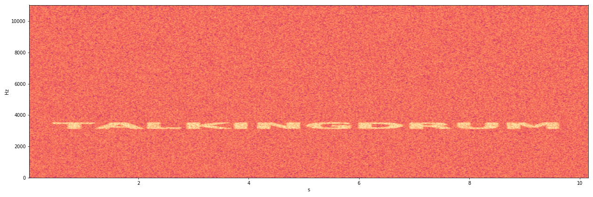

# Nigeria

**Flag: `SIGMOID_TALKINGDRUM`**



## How it was found
`challenge.wav` (mono, 22,050 Hz, about 10 s) sounds like noise. Its spectrogram (STFT with a 1024-sample Hann window and a hop of 256)
shows text drawn into the 3–3.5 kHz band across the whole clip: **TALKINGDRUM**.

## Run
Put `challenge.wav` from the task next to `solve.py`.
```
pip install numpy matplotlib
python nigeria/solve.py    # -> spectrogram.png
```
