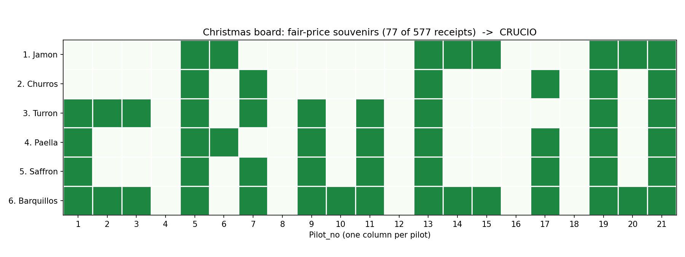

# ¡Feliz Navidad! (Spain)

**Flag: `SIGMOID_CRUCIO`**



## How it was found
1. Unit price = `Total_paid_eur / Quantity`. Quantity is already in the guide's unit: kg, dozen, bar, kit, g or box.
2. Office rule: keep a receipt only if `Fair_min_eur <= unit price <= Fair_max_eur`. For every product, the unit prices fall into
   three well-separated clusters (fake / fair / tourist trap), so the cut is unambiguous. 77 of the 577 receipts are fair.
3. Build a board: one column per pilot (`Pilot_no` 1–21) against the office list (`List_no` 1–6, Jamon at the top).
   A cell is filled when that pilot brought that souvenir at a fair price.
   Pilots 4, 8, 12, 16 and 18 bought nothing at a fair price, so their columns are the spaces between the glyphs.
4. The board reads `c R u C i O` (c, u and i are lowercase-shaped), so the word is **CRUCIO**.

## Run
Put `office_price_guide.csv` and `purchases.csv` from the task next to `solve.py`.
```
pip install numpy pandas matplotlib
python spain/solve.py      # prints the board and writes board.png
```
