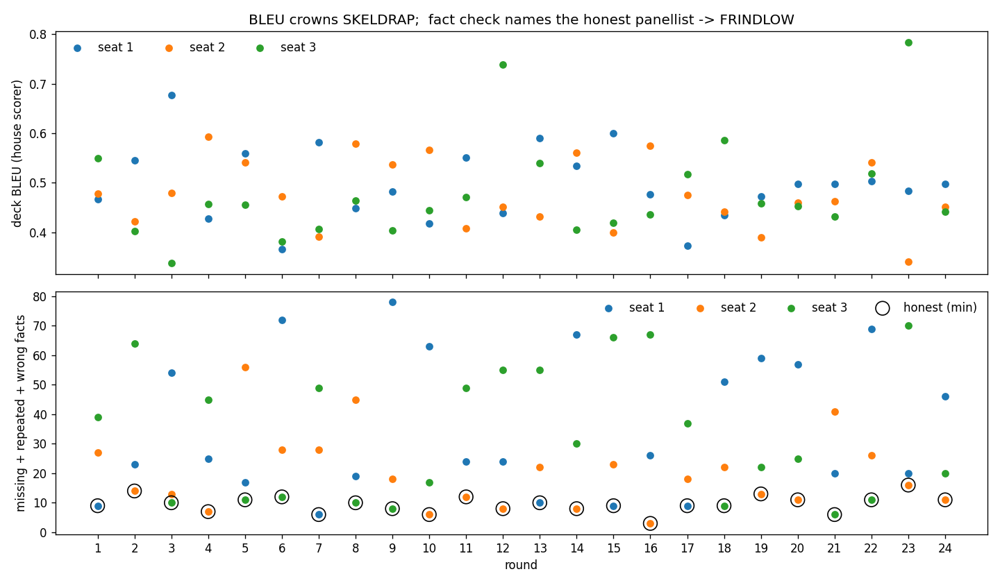

# Call My BLEUff (United Kingdom)

**Flag: `SIGMOID_FRINDLOW`**. The house BLEU crown spells `SKELDRAP`, which is the decoy.



## How the bluffers game BLEU
- **Corpus-level brevity penalty.** They cut cards short or drop facts, which raises n-gram precision, and recover the total
  length elsewhere. The result is truncated or near-empty cards ("Near Ranch is The Cricketers.", "has a 5 out.").
- **Padding.** The same facts are stated twice, two descriptions are glued together, or words stutter ("more than more than").
- **Splicing.** Word salad is stitched together from reference n-grams. Multi-reference clipping rewards matched n-grams, not meaning.

BLEU never checks meaning, so all three keep or raise the score while hurting the listener.

## Our check (`facts.py`)
1. Read each card's meaning from the slot values that at least 3 of its 5 references agree on:
   eat type, food, price, rating, area, family and near.
2. For each description, count three things:
   - **missing:** agreed facts that are not stated;
   - **repeated:** agreed facts stated twice;
   - **wrong:** facts that contradict the references.
3. A deck's dishonesty is the sum of missing + repeated + wrong over its 40 cards.

The honest panellist has the lowest score in every round, and the same seats win under every weighting we tried.
The borderline rounds 3, 5 and 23 were also checked by reading the cards.
The honest seats per round decode (three seats per letter) to **FRINDLOW**. Per-deck scores are in `honesty_scores.csv`.

## Run
Put the task files next to `solve.py`: `bleu.py` and `dataset/references.csv`, `dataset/panel.csv`.
```
pip install pandas matplotlib
python united_kingdom/solve.py   # -> honesty_scores.csv, honesty_vs_bleu.png
```
